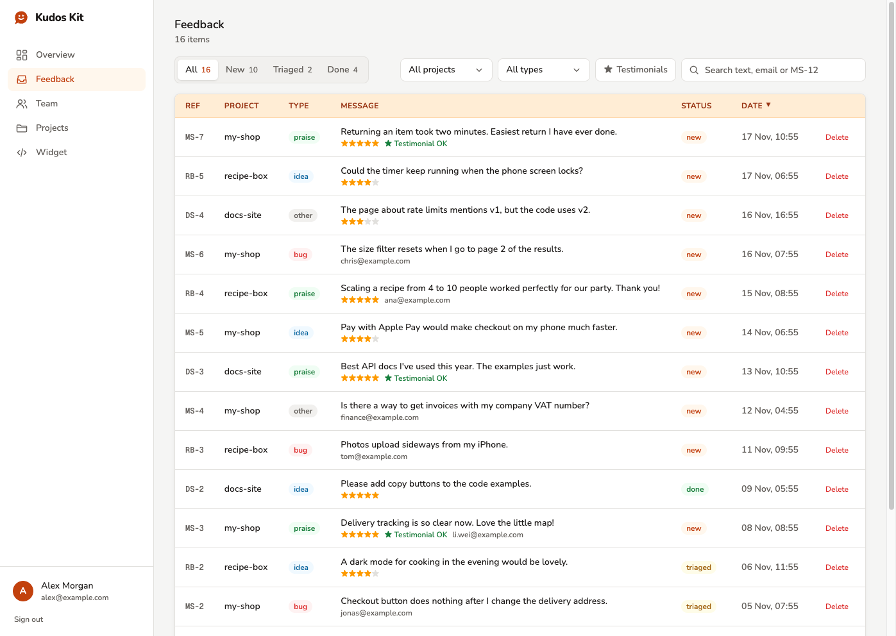
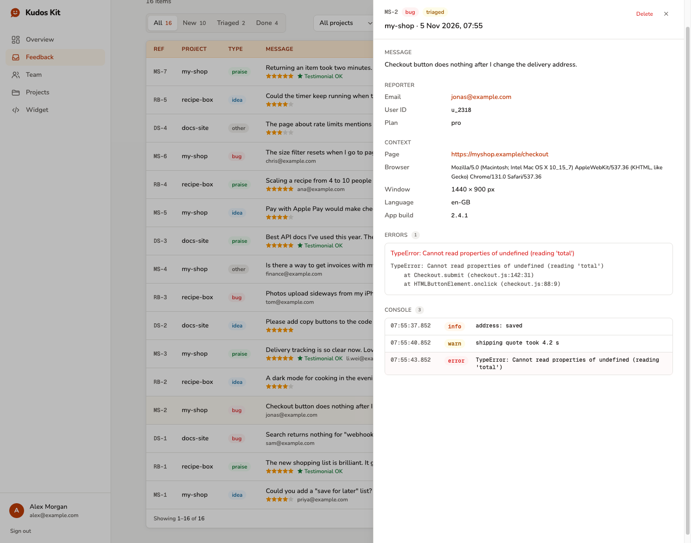
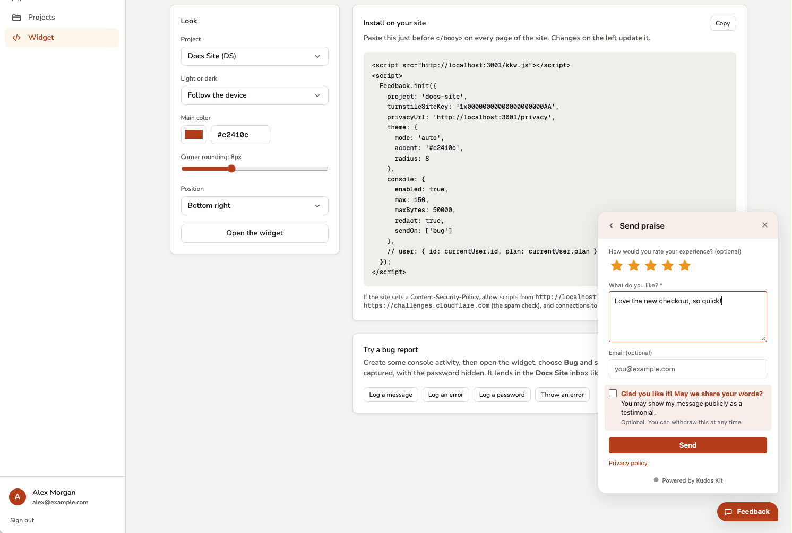
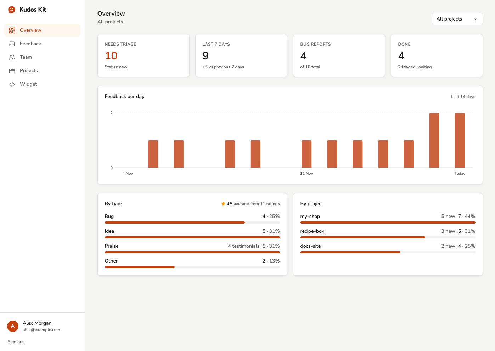

<p align="center">
  
</p>

<h1 align="center">Kudos Kit</h1>

<p align="center">
  <strong>Hear what your users really think.</strong><br>
  Self-hosted, open-source feedback for your apps and websites.
</p>

<p align="center">
  <a href="https://github.com/AdventureSoftware/kudos-kit/actions/workflows/ci.yml"></a>
  <a href="LICENSE"></a>
</p>

Add one script tag and your users get a small **Feedback** button. They report a bug, share an
idea or send praise, and your team reads it all in one inbox, with the page, browser and console
log attached. Everything runs on your own server: no third-party tracking, no per-seat pricing.



## Features

**The widget** (one script, no dependencies)
- Four kinds of feedback: bug, idea, praise, other. Optional 1–5 star rating.
- **Bug reports bring their evidence**: page, browser, window size, app version, and the recent
  console messages and errors. Passwords, tokens and keys in the logs are hidden (best-effort)
  before anything leaves the browser.
- Happy users can let you **use their praise as a testimonial**; their consent is recorded and
  can be withdrawn.
- Matches your app: colours, light/dark/auto, corner rounding, font, position.
  See [widget/THEMING.md](widget/THEMING.md).
- Spam protection with Cloudflare Turnstile and a honeypot field. A draft survives closing the panel.

**The dashboard**
- Overview with daily numbers, ratings and a breakdown per type and project.
- Inbox with filters, search and a simple status: new → triaged → done.
- Short references per project, like `MS-12`, to mention in tickets and chats.
- Several apps in one place (Projects page), and a Widget page to try the widget and copy its code.
- Invite-only team with owner / admin / member roles. Email + password, optional Google and
  Apple sign-in, password reset, optional emails through Brevo.

**Privacy and operations**
- A public privacy page filled in from your settings; feedback deleted automatically after
  90 days (you choose).
- Least-privilege database roles: the public endpoint can only add feedback.
- Docker Compose deployment behind nginx or Caddy; backup, restore and update scripts.

| Bug report with console and error | The widget | Overview |
|---|---|---|
|  |  |  |

## Quick start

You need a Linux server with Docker and a domain name pointing to it.

```bash
git clone https://github.com/AdventureSoftware/kudos-kit.git && cd kudos-kit
./scripts/setup.sh feedback.example.com      # creates .env with fresh secrets
docker compose up -d --build
```

Then put HTTPS in front (an nginx config is included, or set `COMPOSE_PROFILES=caddy` for
automatic certificates), open your address and create the owner account.
**[DEPLOY.md](DEPLOY.md)** walks through every step, including backups and updates.

## Add the widget to a site

The dashboard's **Widget** page lets you try it, adjust the look and copy the code. It looks
like this:

```html
<script src="https://feedback.example.com/kkw.js"></script>
<script>
  Feedback.init({
    project: 'my-shop',
    turnstileSiteKey: '0x4AAAA…',
    privacyUrl: 'https://feedback.example.com/privacy',
    theme: { mode: 'auto', accent: '#c2410c' },
    console: { enabled: true, max: 150, maxBytes: 50000, redact: true, sendOn: ['bug'] },
  });
</script>
```

React and Next.js apps, showing the button to signed-in users only, Content-Security-Policy
settings and the JavaScript API: **[docs/widget.md](docs/widget.md)**.

## Documentation

| | |
|---|---|
| [DEPLOY.md](DEPLOY.md) | Install on a server, HTTPS, backups, updates |
| [docs/configuration.md](docs/configuration.md) | Every setting in `.env` explained |
| [docs/widget.md](docs/widget.md) | Adding the widget to plain sites, React and Next.js; CSP; API |
| [widget/THEMING.md](widget/THEMING.md) | Colours, dark mode, fonts, CSS variables |
| [docs/sign-in-providers.md](docs/sign-in-providers.md) | Google and Apple sign-in |
| [CONTRIBUTING.md](CONTRIBUTING.md) | Local development, tests, how to send changes |
| [SECURITY.md](SECURITY.md) | Reporting a vulnerability |

## How it fits together

```
your site ── kkw.js ──▶ POST /v1/feedback ─┐
                                           ├─ server/  NestJS API, Better Auth  ──▶ PostgreSQL
browser ──▶ dashboard ─────────────────────┘  client/  Next.js dashboard
```

| Folder | |
|---|---|
| `widget/` | The widget (TypeScript, built with esbuild into `server/public/kkw.js`) |
| `server/` | API: feedback intake, dashboard API, sign-in (Better Auth), emails (Brevo) |
| `client/` | Dashboard and home page (Next.js, React, Tailwind) |
| `db/` | Database migrations and `migrate.sh` |
| `deploy/`, `scripts/` | nginx and Caddy configs; setup, backup, restore and update scripts |
| `docs/` | Configuration, widget and sign-in guides |

## Local development

You need Node.js 22 and PostgreSQL 16.

```bash
# Database (once)
createdb feedback
PGDATABASE=feedback DB_INGEST_PASSWORD=dev-ingest DB_ADMIN_PASSWORD=dev-admin sh db/migrate.sh

# Widget → server/public/kkw.js
cd widget && npm install && npm run build && cd ..

# API on :3000. Copy server/.env.example to server/.env and set BETTER_AUTH_SECRET (openssl rand -hex 32).
cd server && npm install && npx prisma generate && npm run start:dev

# Dashboard on :3001 (another terminal)
cd client && npm install && npm run dev
```

Open <http://localhost:3001>: the first visit creates the owner account, then add a project on
the Projects page. Tests: `npm test` in `server/` and `widget/`. More in
[CONTRIBUTING.md](CONTRIBUTING.md).

## Live instance

[kudoskit.io](https://kudoskit.io) is the maintainers' own installation, used for their apps.
It's invite-only, not a hosted service: to use Kudos Kit, run your own copy.

## License

[MIT](LICENSE) © Agile Turtles
